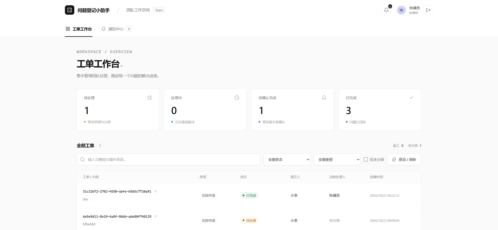
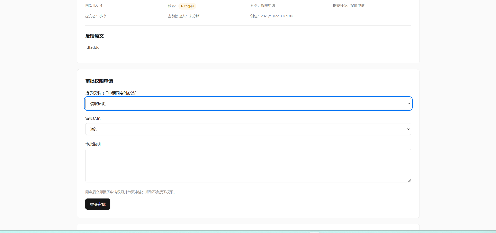

# 企业内部问题登记小助手

一个面向企业内部的问题反馈与工单协作系统。员工可以提交系统故障、权限申请、功能建议和使用咨询，协调员负责分派与审批，技术支持跟进处理，让问题从提交到解决都有记录可查。

项目采用前后端分离架构，支持角色权限控制、图片附件、操作时间线和站内通知，适合内部问题登记、团队协作演示及二次开发。

## 项目预览

准备两张截图，放到 `docs/images/` 目录，使用下面的文件名即可显示。建议使用桌面浏览器截图，宽度约 1440 像素，隐藏密码、真实内部信息及浏览器无关区域。

| 截图 | 保存位置 | 建议内容 |
| --- | --- | --- |
| 工单工作台 | `docs/images/workbench.png` | 使用协调员账号登录，展示状态统计、分类筛选和几条不同状态的工单 |
| 权限申请审批 | `docs/images/permission-approval.png` | 使用协调员账号打开一条待审批权限申请，展示申请权限、申请原因和通过 / 拒绝操作区 |

### 工单工作台



### 权限申请审批



## 核心功能

- **问题登记**：支持系统故障、权限申请、功能建议、使用咨询和待确认五种分类，可上传图片、关联本人已完成工单。
- **工单处理**：协调员分派或转派，处理人开始处理并提交结果，提交者确认完成或要求返工。
- **权限审批与授权**：提交者选择具体系统权限并说明原因；协调员同意后直接授权，拒绝不授权，审批后结束工单，无需再次确认。
- **图片附件**：支持 PNG、JPEG、WebP，单张最大 5 MiB，每个工单最多 5 张；图片保存在 MinIO 私有桶中，经后端校验权限后读取。
- **操作留痕**：保存原始反馈、公开沟通、分派、处理结果及审批记录。
- **站内通知**：通知新工单、分派、回复及处理结果，页面可见时默认每 15 秒刷新未读数量。
- **权限控制**：采用 Session 登录、BCrypt 密码哈希、CSRF 防护与数据库 RBAC；用户直接授权与角色权限合并生效，已有会话在下一次请求时刷新权限。

### 角色与流程

| 角色 | 默认职责 |
| --- | --- |
| 提交者 | 提交问题或权限申请、查看本人工单、补充说明、确认普通工单结果 |
| 协调员 | 查看全部工单、纠正分类、分派 / 转派、处理工单、审批并授予申请权限 |
| 技术支持 | 查看分派给自己的工单、处理问题、提交处理结果 |

上表为默认角色权限；协调员审批授予的具体权限会加入用户的有效权限集合，不改变用户角色。

普通工单：`提交 → 协调员分派 → 处理人开始处理 → 提交结果 → 提交者确认完成 / 要求返工`。

权限申请：`选择权限并提交 → 协调员同意 / 拒绝 → 同意则授予权限 → 工单完成并通知提交者`。

权限授权针对本系统 `permissions` 表中的权限，外部业务系统的账号开通需要另行集成。当前没有自助注册及完整账号管理页面。

## 技术栈与目录

| 层级 | 技术 |
| --- | --- |
| 前端 | Vue 3、TypeScript、Vite、Vue Router、Pinia |
| 后端 | Java 21、Spring Boot 3.5、Spring Security、MyBatis |
| 数据库 | MySQL 8 |
| 图片存储 | MinIO |
| 部署 | Spring Boot JAR + Nginx；可选 Docker Compose 启动数据库和 MinIO |

```text
backend/               后端源码与测试
frontend/              前端源码
database/              数据库 SQL
  ticketing.sql        Navicat 导出的表结构与数据
docs/                  需求、接口、权限与架构说明
  images/              README 展示截图
scripts/               Windows 本地启动脚本
compose.yml            MySQL 与 MinIO 的本地容器配置
.env.example           环境变量示例
```

## 本地部署

### 1. 环境准备

- Java 21、Maven 3.9+
- Node.js 22.12+、npm
- MySQL 8.0.16+、MinIO
- Navicat 或 MySQL 命令行客户端
- Docker / Docker Compose（可选，使用已有数据库和 MinIO 时不需要）

### 2. 配置环境变量

在项目根目录复制配置文件：

```powershell
Copy-Item .env.example .env
```

根据实际环境编辑 `.env`。以下示例适配仓库的 Compose 配置；请替换所有密码占位符，不要将真实凭据提交到仓库。

```dotenv
DB_URL=jdbc:mysql://127.0.0.1:3306/ticketing?connectionTimeZone=UTC&forceConnectionTimeZoneToSession=true&characterEncoding=UTF-8
DB_USERNAME=ticketing
DB_PASSWORD=replace-with-database-password
MYSQL_ROOT_PASSWORD=replace-with-different-root-password
MINIO_ENDPOINT=http://127.0.0.1:9000
MINIO_ACCESS_KEY=replace-with-minio-user
MINIO_SECRET_KEY=replace-with-minio-password
MINIO_BUCKET=ticketing-images
DEMO_ENABLED=false
DEMO_PASSWORD=replace-with-demo-password-at-least-12-characters
SERVER_PORT=8080
SESSION_COOKIE_SECURE=false
```

配置文件使用不带引号的 `NAME=value` 格式。Compose 创建的应用数据库账号为 `ticketing`，`DB_USERNAME` 要与之对应；使用已有数据库时填写实际账号。

使用远程 MinIO 时，将 `MINIO_ENDPOINT` 改为 `http://服务器IP:9000`，同时填写该服务器有效的访问凭据。后端连接的是 **API 端口**，不是控制台端口；例如服务器将控制台映射到 9090 时，浏览器访问 9090，后端仍配置 API 的 9000。

### 3. 准备 MySQL 和 MinIO

已有可用服务可跳过容器启动。在项目根目录执行：

```powershell
docker compose up -d
```

仓库 Compose 默认映射：

| 服务 | 地址 |
| --- | --- |
| MySQL | `127.0.0.1:3306` |
| MinIO API | `http://127.0.0.1:9000` |
| MinIO 控制台 | `http://127.0.0.1:9001` |

端口仅绑定本机。已有 MySQL 占用 3306 时，可只启动 `docker compose up -d minio`，或调整 Compose 主机端口并同步修改 `DB_URL`。修改 `.env` 不会重置已有 MySQL 数据卷中的账号密码。

**初始化数据库：**

1. 在 Navicat 中连接 MySQL，创建字符集为 `utf8mb4` 的空数据库 `ticketing`（Compose 已自动创建时直接使用）。
2. 右键该数据库 → **运行 SQL 文件** → 选择项目中的 `database/ticketing.sql`。
3. 导入完成后，确认存在 `users`、`roles`、`permissions`、`tickets`、`user_permission` 等表。

命令行也可以在选定数据库后导入：

```sql
USE ticketing;
SOURCE F:/MyProject/github/Ticketing/database/ticketing.sql;
```

将 `SOURCE` 路径替换为你的实际路径。该文件包含建表和数据，带有 `DROP TABLE IF EXISTS`，**只用于初始化空库或明确执行完整恢复，不要直接导入有业务数据的数据库**。应用不会自动建表；普通升级需单独准备增量 SQL。

**初始化图片桶：**

1. 打开 MinIO 控制台，使用 `.env` 对应的 `MINIO_ACCESS_KEY` / `MINIO_SECRET_KEY` 登录。
2. 进入 **Buckets → Create Bucket**，创建 `ticketing-images`，保持私有权限。
3. 已有其他桶时，让 `MINIO_BUCKET` 与实际桶名称一致。

SQL 只保存图片元数据，不包含图片文件。导入 SQL 后若要查看历史图片，还需从原 MinIO 迁移对应桶中的对象，并保留原对象路径；也可以先通过新工单上传一张图片验证存储。

### 4. 启动后端

在项目根目录打开 PowerShell：

```powershell
.\scripts\Start-Backend.ps1
```

脚本会读取根目录 `.env`，然后启动 Spring Boot。健康检查地址为 `http://127.0.0.1:8080/api/health`，正常返回 `{"status":"UP"}`。

直接从 IDEA 或执行 `mvn spring-boot:run` 时，需要自行设置相同环境变量；Spring Boot 不会自动加载根目录 `.env`。修改连接配置后需重启后端。健康接口只验证进程存活，不能替代数据库及图片上传检查。

### 5. 启动前端与登录

另开一个终端：

```powershell
cd frontend
npm ci
npm run dev
```

浏览器打开 `http://127.0.0.1:5173`。开发服务器将 `/api` 请求代理到本机 8080 端口。

| 演示账号 | 角色 |
| --- | --- |
| `requester1`、`requester2` | 提交者 |
| `coordinator1` | 协调员 |
| `support1`、`support2` | 技术支持 |

**从 SQL 导入的账号保留原数据库密码**，应使用导出前的登录密码。SQL 保存的是 BCrypt 哈希，不能从中读取明文密码。

`DEMO_ENABLED=true` 时，应用只为缺失的演示账号创建用户，密码取自 `DEMO_PASSWORD`（至少 12 个字符，UTF-8 不超过 72 字节）；**不会覆盖导入账号的已有密码**。正式使用应关闭演示初始化，并配置独立账号与密码。

### 6. 验证业务流程

- 提交者新建一条普通工单并上传图片；协调员分派给技术支持，处理后由提交者确认。
- 提交者申请“读取全部工单”等权限；协调员直接同意，提交者刷新工作台后检查新权限是否生效。
- 再提交一条申请并拒绝，确认工单结束且没有新增授权。

## 服务器部署

以下以单台 Linux 服务器为例：MySQL、MinIO 继续按上述方式准备，后端运行 JAR，Nginx 同时提供前端静态文件和 `/api` 反向代理。示例假设源码位于 `/opt/ticketing`。

### 1. 构建与启动后端

在已安装构建工具的环境执行：

```bash
cd /opt/ticketing/backend
mvn -DskipTests package
cd ../frontend
npm ci
npm run build
```

后端产物为 `backend/target/ticketing-backend-0.1.0-SNAPSHOT.jar`，前端产物为 `frontend/dist/`。也可以在本地完成构建后，将产物与部署配置上传到服务器。

将实际环境变量配置到 `/opt/ticketing/.env`。在服务器上使用专用服务账号运行后端：

```bash
sudo useradd --system --home-dir /opt/ticketing --shell /usr/sbin/nologin ticketing
sudo chown root:ticketing /opt/ticketing/.env
sudo chmod 640 /opt/ticketing/.env
```

已有同名服务账号时跳过创建。确保该账号能够读取 JAR 和访问父目录。创建 `/etc/systemd/system/ticketing.service`：

```ini
[Unit]
Description=Ticketing application
After=network.target

[Service]
Type=simple
User=ticketing
WorkingDirectory=/opt/ticketing/backend
EnvironmentFile=/opt/ticketing/.env
ExecStart=/usr/bin/java -jar /opt/ticketing/backend/target/ticketing-backend-0.1.0-SNAPSHOT.jar
Restart=on-failure
RestartSec=5

[Install]
WantedBy=multi-user.target
```

将 Java 路径、JAR 路径和文件名替换为服务器实际值，然后执行：

```bash
sudo systemctl daemon-reload
sudo systemctl enable --now ticketing
sudo systemctl status ticketing
# 查看日志
sudo journalctl -u ticketing -f
```

### 2. 配置 Nginx

安装 Nginx 后，在站点配置中加入以下内容，并替换域名与前端目录：

```nginx
server {
    listen 80;
    server_name your-domain.example;
    root /opt/ticketing/frontend/dist;
    index index.html;
    client_max_body_size 26m;

    location /api/ {
        proxy_pass http://127.0.0.1:8080;
        proxy_set_header Host $host;
        proxy_set_header X-Real-IP $remote_addr;
        proxy_set_header X-Forwarded-For $proxy_add_x_forwarded_for;
        proxy_set_header X-Forwarded-Proto $scheme;
    }

    location / {
        try_files $uri $uri/ /index.html;
    }
}
```

`proxy_pass` 保留上述写法，以保留请求中的 `/api` 路径；`try_files` 用于支持 Vue 路由直接访问与刷新。确保 Nginx 用户能读取前端目录。

```bash
sudo nginx -t
sudo systemctl reload nginx
```

浏览器通过域名或服务器 IP 访问，前端和 API 使用同一站点地址。正式对外提供服务时配置 HTTPS，并设置 `SESSION_COOKIE_SECURE=true` 后重启后端；本地 HTTP 调试保持 `false`。数据库、MinIO 和后端端口应仅允许应用所需的网络访问。

当前 Session 保存在单个后端实例中，上述方案按单实例部署。MySQL 与 MinIO 都需要持久化存储和独立备份。

## 常见问题

| 现象 | 排查方向 |
| --- | --- |
| 登录失败 | 导入账号使用原密码；修改 `DEMO_PASSWORD` 不会重置已有密码；确认后端连接的是正确数据库 |
| 提示图片存储不可用 | 检查 MinIO API 地址、访问凭据、私有桶名称；确认服务可达且桶已创建 |
| 历史图片打不开 | SQL 不包含图片对象，检查是否迁移了原 MinIO 桶及对象路径 |
| 权限审批入口不显示 | 确认使用协调员账号，数据库包含 `ticket:access:approve` 及其角色授权，后端已更新并重启 |
| 前端 API 请求失败 | 开发时检查后端 8080 端口；部署后检查 Nginx `/api/` 代理与端口配置 |
| 刷新详情页出现 404 | 检查 Nginx 是否配置了 `try_files $uri $uri/ /index.html` |

## 测试与文档

```bash
# 后端测试（默认不运行需要真实数据库的集成测试）
cd backend
mvn test

# 前端测试与构建
cd ../frontend
npm test
npm run build
```

真实数据库授权测试需先准备完整表结构，设置 `TICKETING_DB_INTEGRATION=true` 及数据库环境变量后执行 `mvn -Dtest=PermissionGrantIntegrationTest test`；测试记录通过事务回滚。

- [需求规格说明书](docs/需求规格说明书.md)
- [系统架构设计](docs/系统架构设计.md)
- [RBAC 权限设计](docs/RBAC权限设计.md)
- [数据库设计](docs/数据库设计.md)
- [API 与操作说明](docs/API与操作说明.md)
- [架构设计与通知方案对比](docs/架构设计与通知方案对比.md)
