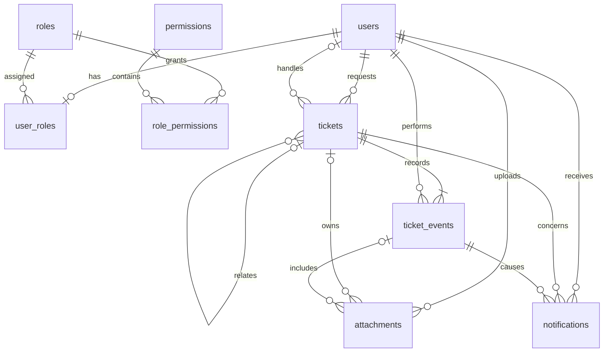

# 数据库设计

版本 V1.0，2026-10-21。技术方案：Spring Boot + Vue + MySQL + MinIO；红点采用定时轮询。本设计补充图片能力并细化既有需求，数据库和应用尚未部署验证。

## 1. 设计约定

- DDL 见 [database/schema.sql](../database/schema.sql)，目标 MySQL 8.0.16+，推荐新项目使用支持中的版本。CHECK 约束语义参考 [MySQL 文档](https://dev.mysql.com/doc/refman/8.4/en/create-table-check-constraints.html)。
- 使用 InnoDB、utf8mb4；内部主键 BIGINT UNSIGNED；应用建议将 ID 以字符串返回 Vue，避免 JavaScript 大整数精度损失。
- 时间统一 UTC DATETIME(6)，连接也设置 UTC，页面显示北京时间。updated_at 和 version 由业务事务明确维护，不依赖自动更新时间代替业务版本。
- 不级联删除用户、工单、历史、通知或已绑定附件；账号停用不删除历史。三年保留同时涵盖已绑定图片、MySQL 备份和 MinIO 对象备份。
- 工单历史统一事件表承载，暂不单独建立回复表、结果表和分派表。类型及结构化 changes 区分事件，便于展示时间线和保持事务一致。
- 分类、状态是固定业务枚举，不提供任意编辑字典；附件不是分类输入，首期不识别图片内容。

## 2. 表清单

| 表 | 职责 | 关键约束 |
| --- | --- | --- |
| users | 登录用户、显示名、密码哈希、启停状态 | username 唯一 |
| roles | REQUESTER、COORDINATOR、SUPPORT 三种角色 | code 唯一 |
| permissions | 操作权限码 | code 唯一 |
| user_roles | 用户角色关联 | 首期 user_id 唯一，一个账号一个角色 |
| role_permissions | 角色与权限关联 | 组合主键，防止重复授权 |
| tickets | 工单当前状态、归属和分类 | request_id 全局唯一、状态与分类 CHECK、版本号 |
| ticket_events | 公开沟通、分派历史、处理结果、返工及验收 | 只追加，不通过普通接口修改删除 |
| attachments | MinIO 图片元数据、临时上传与工单关联 | 对象键唯一、绑定事件与工单必须一致 |
| notifications | 每个接收人的未读/已读消息 | 接收人+事件+类型唯一，防止重复提醒 |

共 9 张表。不设置独立“红点表”或未读计数字段，先根据 notifications 索引查询，避免维护两份计数。

## 3. ER 图

## 4. 工单主表

| 字段 | 含义 |
| --- | --- |
| id / request_id | 内部 ID / 外部唯一提交编号，禁止用显示名识别用户 |
| requester_id / assignee_id | 原提交人 / 当前处理人，转派时更换后者 |
| original_text | 原始反馈，不被清洗、摘要或人工纠正覆盖 |
| creation_digest | 原始提交载荷摘要，包含图片集合，用于重试和冲突判断 |
| initial_category / category | 提交者最初选择 / 当前分类，协调员纠正不覆盖最初选择 |
| status | PENDING / IN_PROGRESS / AWAITING_CONFIRMATION / REWORK / COMPLETED |
| related_ticket_id | 原提交者本人已完成工单的内部 ID，可空 |
| resolution_code | 当前处理结论：RESOLVED、ANSWERED、APPROVED、REJECTED、ACCEPTED、DEFERRED，可空；返工清空，历史结果保留 |
| version | 并发控制版本，所有工单写操作包括追加沟通和绑定图片均递增 |
| created_at / updated_at / completed_at | 创建、最近业务变化、提交者确认完成时间 |

request_id 采用 ASCII、大小写敏感唯一比较，服务端拒绝首尾空白，仅允许字母、数字、下划线和连字符。不能使用数据库默认大小写不敏感比较代替约定。

同一人同编号重试时比较载荷：原文、提交者选定的初始分类、关联 ID、初始附件 token 的排序后集合。服务端用无歧义的固定格式序列化计算摘要，不信任客户端摘要；必要时核对实际原始值。图片顺序首期无业务含义。后续纠正 category 不修改 initial_category 或 creation_digest，原请求重试仍按初始分类比较。

分类必填，不设置默认值；UNCONFIRMED 也须提交者主动选择。schema.sql 是当前完整结构，包含处理结论字段，不含旧自动分类字段；data.sql 初始化角色权限。使用 MySQL 8 手动执行 SQL，不使用自动迁移；已有本项目表按 database/README.md 说明补齐，不重复建表或清库。

assignee_id 可以指向协调员或技术支持；外键只保证用户存在，具体角色、账号有效性以及仅当前处理人可执行处理动作由服务层保障。

已绑定图片不可替换；后续补图通过新事件，不改变创建摘要。重试需携带原始附件 token；在校验临时附件是否可绑定之前，先按身份和 request_id 判断是否为已成功请求的重试。

## 5. 事件模型

事件类型：CREATED、CATEGORY_CHANGED、ASSIGNED、REASSIGNED、STARTED、COMMENTED、SUPPLEMENTED、RESULT_SUBMITTED、REWORK_REQUESTED、COMPLETED。

- content 保存公开消息或变更原因；changes JSON 保存状态、分类、处理人等前后值，字段结构由事件类型固定，服务端生成。
- 所有事件对有权访问本工单的人可见，不设内部备注。完成后不可追加业务事件。
- 每次 RESULT_SUBMITTED 单独保存，不覆盖上一次结果；“当前结果”查询最近一次该事件，返工原因也逐次保留。
- 在工单锁范围内先更新状态、再插入事件与通知，同一事务提交。时间线按 created_at、id 排序。
- 不把整个工单或用户实体直接序列化到 changes，避免复制密码、身份凭据或无关个人信息。

## 6. 图片与 MinIO

### 6.1 范围与限制

- 提交者创建工单、补充信息时允许附图；首期协调员和支持人员仅文字回复，不开放图片上传权限。
- 建议默认每张工单累计最多 5 张，每张最多 5 MiB；PNG、JPEG、WebP。限制为首期实现约定，可后续配置。
- 必须有非空白反馈文字并主动选择分类，不能仅传图片。图片用于展示，不进行类型识别。
- 服务端验证真实文件格式、文件大小、可解码性、尺寸和解码像素上限，不相信扩展名或客户端 Content-Type；拒绝 SVG/HTML 等主动内容。
- original_filename 只作为展示文本，不能用于路径或原样拼接响应头；object_key 由服务端随机生成，如 uploads/2026/10/21/{uuid}.png。

### 6.2 存储与访问

MinIO 桶设为私有，不允许匿名列举或读取。MySQL 只保存 bucket_name、object_key、大小、真实 MIME、校验哈希和关联，不存二进制、访问密钥或永久 URL。MinIO 地址和密钥使用服务端配置。

后端图片接口根据 attachment.id 查库，按其工单当前归属检查权限，再从 MinIO 代理读取。默认不向浏览器签发可重复使用的预签名地址；这类地址在过期前通常不随工单转派立即失效。

响应使用正确 Content-Type、X-Content-Type-Options: nosniff 和 Cache-Control: private, no-store；退出和转派导致详情失效时前端清理当前图片引用。已经传输到用户设备的图像不能追溯撤回。

临时图片只有上传者本人可预览；已绑定图片统一按工单权限访问，即使上传者本人也不能绕开工单授权。

### 6.3 生命周期与跨系统一致性

1. 后端认证上传者为 REQUESTER，验证文件，生成 token 和对象键，写入 UPLOADING 临时行及过期时间。
2. 后端上传到 MinIO；确认对象成功保存后将该行改为 READY，再向浏览器返回 token。上传接口本身需限流和限制临时附件总量。
3. 创建工单或补充信息时，锁定工单及临时附件行，核对上传者、READY、未过期、实际对象可用和数量限制。
4. 同一 MySQL 事务插入工单/事件，附件变 BOUND 并关联事件，expires_at 清空；同时写通知。初始图片归 CREATED，补图归 SUPPLEMENTED。
5. 工单事务失败时附件仍临时，可重试；不能因为绑定事务失败删除可能已成功绑定的对象。
6. 未绑定附件建议 24 小时过期。清理任务锁定到期临时行并改为 DELETE_PENDING，提交后幂等删除 MinIO 对象，成功后删除临时元数据；失败保留状态重试。

MySQL 与 MinIO 没有同一数据库事务。通过临时状态、补偿清理和定期核对处理失败，不声称两者具有原子提交。不能仅按对象创建时间配置 MinIO 自动清理，否则会误删早先上传、后来绑定的图片。

UPLOADING 和 READY 均可到期清理；上传请求结束前再次检查状态，防止慢请求与清理竞争。BOUND 不参与临时对象清理，存储缺失时保留元数据并报告不可用，不能静默删除工单历史。

## 7. 通知与红点轮询

- Vue 页面可见时每 15 秒请求本人有效未读数，后台暂停，重新可见或重登立即刷新；演示可配置为 3–5 秒。
- 未读条件：recipient_id 为本人、read_at IS NULL、invalidated_at IS NULL，且当前仍有工单读取权限。
- 不存正文副本，显示内容按事件和当前工单权限查询；通知不能扩大工单访问权限。
- 读取只修改本人的 read_at；已读不是完成待办。工作台待办数量查询 tickets，不使用 notifications 数量代替。
- 转派事务中将原支持人员该工单有效通知设置 invalidated_at，新支持获得新分派通知；查询仍额外检查当前归属。
- 唯一约束防止同一事件向同一人重复提醒；幂等创建不生成新事件，不发重复通知。
- 首期不提供“全部已读”，避免在通知尚未加载或并发新消息到达时误标；仅提供单条已读。后续如增加应设计精确快照边界。

## 8. 数据库约束与应用职责

| 数据库保障 | 应用事务内保障 |
| --- | --- |
| request_id 唯一；外键存在性；角色关系不重复 | 身份、RBAC、本人/当前处理人数据范围 |
| 状态、分类、事件类型合法 | 状态流转合法、提交者验收、已完成只读 |
| 附件事件和工单一致；存储对象键唯一 | 支持角色有效、关联目标属于本人且已完成 |
| 附件大小和 MIME 枚举、字段长度上限 | Unicode 非空白校验、真实图片检查、每工单累计图片数 |
| 通知事件归属及投递唯一 | 接收人计算、转派失效和通知权限过滤 |

CHECK 约束不能验证跨表角色或外部 MinIO 对象，这些不能遗漏服务层检查。上线时运行账号不应具备修改表结构权限。

## 9. 索引和并发

- tickets：提交者+创建时间；处理人+状态+创建时间；全局状态、分类列表索引。列表使用时间与 ID 稳定排序，按实际慢查询增减索引。
- ticket_events：工单+时间+ID，支持详情时间线。
- notifications：接收人+失效+已读+ID，支持轮询；另有接收人列表及工单转派失效索引。
- attachments：工单列表、临时过期清理、上传者临时对象查询索引。
- 工单写入使用 SELECT ... FOR UPDATE 锁定工单，再验证最新身份归属/状态及前端版本，完成后 version + 1。涉及附件时按 ID 排序锁定，降低死锁概率；死锁需整体回滚并有限重试。
- 原技术支持操作与转派必须使用相同工单锁，不能授权通过后脱离事务直接写历史或附件。
- 本期没有真实性能测试，不承诺并发指标。

## 10. 初始化与验证状态

1. 建立专用空数据库并选择该库，然后执行 schema.sql；脚本不含 DROP、TRUNCATE 或数据库创建语句。
2. 初始化三种角色、RBAC 文档中的权限，以及预置用户和角色关系；密码哈希由应用生成，不在脚本中写默认明文凭据。
3. 创建私有 MinIO 桶并配置服务端最小权限凭据，初始不允许浏览器直连。
4. 按需求与附件边界执行集成测试，重点覆盖并发 request_id、图片绑定重试、越权图片访问、转派、MinIO 故障和过期清理。

当前仅完成 DDL 和文档静态检查，尚未向本地 MySQL 执行建表、初始化用户、创建 MinIO 桶或运行数据库集成测试。
