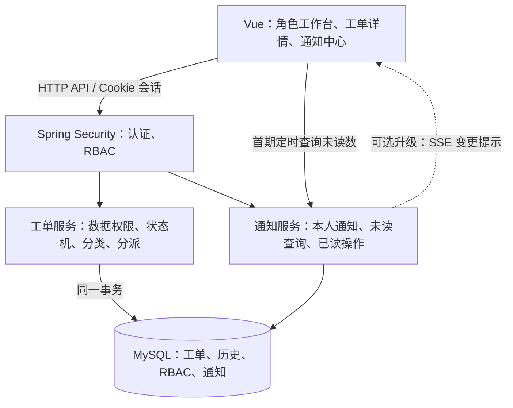

# 架构设计与通知方案对比

日期：2026-10-21。轮询方案已选定，图片使用 MinIO；本文保留早期通信方案比较供参考。最终架构以 [系统架构设计](./系统架构设计.md) 为准，表结构以 [数据库设计](./数据库设计.md) 为准，首期仅单条已读，不提供全部已读。代码实现状态见根目录 README，未做性能测试。

## 1. 总体架构

采用 Vue + Spring Boot 模块化单体 + MySQL。首期不引入 Redis 或消息队列。

前端：Vue、Vue Router、Pinia，以及简单组件库。登录用户与未读数集中管理；每个浏览器页面只启动一个通知刷新循环。

后端按业务组织 auth、iam、ticket、notification、audit 模块，各模块内部按 Controller、Service、Mapper 分层。持久化采用 MyBatis，MySQL 8 手动执行 SQL 初始化，不自动迁移。类型由提交者必选，不设置自动分类模块。不以角色拆分三套工单服务。

开发时使用 Vite 代理 /api；部署时由反向代理统一前端和 /api 域名，使用服务端 Cookie 会话。版本选择在初始化项目时核对受支持版本并固定依赖。

## 2. 两种数字必须分开

- 未读通知数：尚未读过且当前有效的通知数量，可因阅读而减少。
- 待办工单数：当前需要本人执行动作的工单数量，只随业务状态、分派归属改变，不因阅读而减少。

建议页头铃铛显示未读通知红点/数量；工作台显示未分派、待开始、返工、待本人确认等业务数量。“全部已读”不能清空待办。

## 3. 通信方案对比

| 方案 | 做法 | 提醒时效 | 优点 | 代价 | 建议 |
| --- | --- | --- | --- | --- | --- |
| 普通轮询 | 前端每隔一段时间请求未读数 | 通常一个轮询周期内，后台页可能更慢 | 易实现和验证，重连简单，离线通知自然补回 | 无消息时也请求，有延迟 | 首期优先 |
| 长轮询 | 请求保持等待，变更或超时后再次请求 | 接近实时 | 仍使用 HTTP | 挂起、超时、重连和资源管理更复杂 | 当前无明显优势 |
| SSE | 单向长连接，服务器推送变更提示 | 在线连接正常时接近实时 | 符合服务端提醒场景；MVC 可用 SseEmitter | 心跳、清理连接、代理超时、多标签与多实例需处理 | 需要即时演示时升级 |
| WebSocket | 持续双向通信，可配合 STOMP | 在线连接正常时接近实时 | 适合聊天、在线协作等双向事件流 | 连接认证、订阅授权、重连、心跳和多实例路由更复杂 | 暂不选 |

无论传输方式如何，通知均先写数据库。WebSocket/SSE 不自行保证断线不丢、业务事务一致或消息持久化。

## 4. 首期建议：持久化通知 + 轮询

- 登录、页面恢复可见、网络恢复时立即刷新未读数及相关业务列表。
- 页面可见时每 15 秒查一次；页面隐藏时暂停，恢复时补查。演示可配置为 3–5 秒。
- 请求串行调度，前次未完成不发下一次；失败退避重试，退出登录时取消定时器和请求。
- 用户本人完成写操作后立即刷新相关状态与未读数，不等待下一轮询。
- 多标签首期各自轮询；后续可用 BroadcastChannel 协调刷新。
- 假设 100 个活跃页面，每 15 秒请求一次约 6.7 次/秒；这是请求量估算，实际性能需测试。后台暂停、多标签与请求耗时会改变实际数值。

## 5. 建议通知对象

| 事件 | 接收人 |
| --- | --- |
| 新建工单 | 全部有效协调员，各自独立已读 |
| 首次分派 | 新处理人、提交者 |
| 转派 | 新处理人、提交者；其他协调员按需要接收 |
| 提交者补充信息 | 当前处理人；未分派时通知协调员 |
| 技术支持或协调员回复 | 提交者；需要另一方协同时通知当前处理人或协调员 |
| 提交处理结果 | 提交者，提示待确认 |
| 要求返工 | 当前处理人、协调员 |
| 确认完成 | 当前处理人、协调员 |

同一事件同一接收人只生成一条；不通知事件操作者本人。协调员通知的已读互不影响，但工单被分派后，“未分派”待办数量对所有协调员减少。

## 6. 通知存储和事务

建议 notifications 字段：id、recipient_id、ticket_id、event_id、type、created_at、read_at、invalidated_at。索引覆盖接收人、有效状态、未读与排序；唯一约束 (recipient_id, event_id, type) 防止重复通知。

不在通知里复制反馈原文或敏感回复；列表按当前权限关联工单并返回必要摘要。

业务事务内依次完成：校验角色/归属/状态与版本 → 修改工单 → 插入历史事件 → 插入接收人通知 → 提交。任一步失败整体回滚。幂等提交不新增事件和通知。

通知插入失败时，本期整体业务操作失败并明确提示重试，以换取工单与通知一致性。接收人数很少，暂不异步扇出。

若升级 SSE，只在事务提交后发出“通知已变化”提示，前端收到后重新查询数据库中的未读数和通知列表。推送遗漏时，首次连接、重连及低频兜底查询修正状态。

## 7. 已读和权限

- 打开通知面板不自动全部已读；点击某条通知并成功进入有权查看的详情后，将该通知标记已读。
- 标记已读只允许 recipient_id 为当前用户的通知，重复操作幂等。
- “全部已读”使用服务端生成的截止时间/快照边界，只处理当时已存在的本人通知；随后到达的通知仍未读。
- 读取通知不确认工单完成；确认完成是单独的、受状态和角色约束的动作。
- 转派在同一事务中失效原处理人该工单的通知，清除未读影响；通知查询和点击目标仍重新校验当前权限。
- 新处理人收到分派通知并可查看工单历史，原处理人不得通过旧通知读取详情。
- SSE 推送仅发“变化”提示，避免转派前排队消息携带原文；会话失效时关闭连接，不能仅凭已建立连接永久信任用户。

## 8. API 建议

| 方法 | 路径 | 用途 |
| --- | --- | --- |
| GET | /api/me | 当前用户与权限 |
| GET | /api/notifications/unread-count | 本人有效未读数 |
| GET | /api/notifications | 本人通知分页 |
| PUT | /api/notifications/{id}/read | 本人单条已读 |
| POST | /api/notifications/read-all | 截止快照的本人通知批量已读 |
| GET | /api/workbench/counts | 按角色和数据范围查询待办数量 |
| GET | /api/notifications/stream | 可选 SSE 升级，不是首期必须 |

工单 API 按 create、assign、reassign、start、submit-result、confirm、rework 等动作设计。所有查询和写入继续遵守 RBAC 文档；通知接收资格不替代工单授权。

## 9. 升级路径

1. 首期：单实例 + MySQL 持久化通知 + 轮询，完成闭环与通知测试。
2. 需要即时性时：保留同一套通知表/API，增加 SseEmitter 和 Vue EventSource；处理心跳、超时、断线清理、登录失效与代理缓冲。
3. 多实例时：解决跨节点提示与会话共享。可增加 Redis 等跨节点分发；若要求提示可靠重试，采用事务 Outbox，并配合幂等消费。MySQL 继续保存未读事实。
4. 真正需要双向实时聊天/协作时，再评估 WebSocket。普通工单回复可继续使用 HTTP。

## 10. 通知验收

验证新工单通知协调员、分派通知支持人员、提交结果通知提交者、读取不消除待办、确认完成才消除待确认任务、离线重登可补查、重复提交不重复提醒、多协调员独立已读、转派后旧通知失效、并发全部已读不误吞新通知，以及通知查询不能越权。

## 参考资料

- [Spring MVC 异步请求及 SseEmitter](https://docs.spring.io/spring-framework/reference/6.2/web/webmvc/mvc-ann-async.html)
- [Spring WebSocket / STOMP](https://docs.spring.io/spring-framework/reference/web/websocket/stomp.html)
- [Spring WebSocket 示例](https://spring.io/guides/gs/messaging-stomp-websocket)
