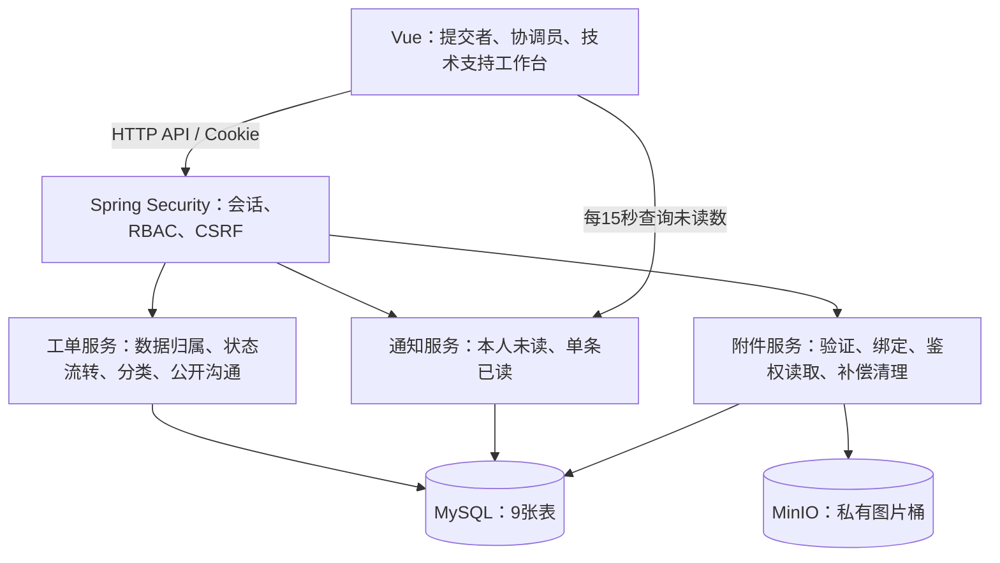

# 系统架构设计

版本 V1.0，2026-10-21。已选定 Spring Boot + Vue + MyBatis + MySQL 8 + MinIO，通知使用定时轮询。已建立基础工程；实际实现进度与验证情况以根目录 README 和测试记录为准，完整业务与部署尚未验证。

## 1. 系统结构

采用单体后端，模块之间通过 Java 服务调用。角色共享同一工单业务，不拆三套系统。首期无 Redis、消息队列、SSE 或 WebSocket。

## 2. 前后端模块

前端使用 Vue Router 管理页面，Pinia 管理当前用户、权限与通知数量，HTTP 客户端统一处理 401、403、404、409。页面按钮按可执行动作显示，最终授权由后端执行。

| 后端模块 | 责任 |
| --- | --- |
| auth / iam | 登录会话、账号有效性、角色权限、支持人员候选 |
| ticket | 业务动作、状态机、归属和并发控制 |
| ticket/domain/TicketCategory | 提交者必选类型枚举及合法值校验，不进行自动识别 |
| audit | 工单事件、公开时间线、处理结果与原因 |
| attachment | 图片校验、MinIO 操作、临时绑定和清理 |
| notification | 计算接收人、保存通知、查询未读与标记已读 |

各模块内分 Controller、Service、Mapper；持久化采用 MyBatis 和 Mapper XML，数据库使用 MySQL 8，结构与角色权限通过 database 目录的 SQL 手动初始化，不自动迁移。

## 3. 请求与事务

普通业务请求流程：身份认证 → 操作权限 → 数据归属 → 工单锁和版本检查 → 状态及输入检查 → 更新工单、追加事件、绑定图片、写通知 → 提交事务。

服务端必须在同一个工单锁范围内完成最新归属校验与写入，防止转派后旧处理人继续修改。request_id 唯一约束保障并发重试不重复创建，重复请求不重复通知。

MySQL 与 MinIO 不共享事务，使用临时附件 READY/BOUND 状态和过期补偿清理。先上传后绑定，不能在数据库事务回滚后无条件删除对象。具体流程见 [数据库设计](./数据库设计.md)。

## 4. 红点轮询

- 每个 Vue 页面启动一个刷新循环，页面可见时每 15 秒查询本人有效未读数，演示可配置 3–5 秒。
- 页面隐藏暂停，恢复可见、网络恢复和重新登录时立即补查。串行请求，失败退避，退出时取消。
- 点击通知并成功打开有权查看的工单后标记该条已读；首期不实现全部已读。
- 通知红点与业务待办分开：已读清除提醒，只有业务动作完成才改变待办数量。
- 离线期间通知仍保存于 MySQL，重新登录查询即可看到；原支持转派后通知失效，附件访问同步按最新归属拒绝。

通知对象与历史方案比较见 [架构设计与通知方案对比](./架构设计与通知方案对比.md)。

## 5. 图片访问与安全

MinIO 私有桶；凭据只在后端。前端按附件 ID 调用后端，后端验证工单读取权限后代理图片流，不提供永久公开 URL 或前端直连凭据。

默认累计每工单最多 5 张，每张 5 MiB，PNG/JPEG/WebP；服务端检查实际内容和解码大小。临时图片仅上传者可预览，绑定后沿用工单权限。响应禁止共享缓存；已下载内容无法追溯收回。

会话使用 HttpOnly、SameSite Cookie，写接口启用 CSRF 防护；部署 HTTPS 后启用 Secure。开发 Vite 代理 /api，部署采用统一域名代理前端与 API。MinIO 管理端口不暴露给普通用户。

## 6. 部署和运维边界

本地依赖包括 JVM、MySQL、MinIO 和前端开发/构建环境；后续通过配置或容器编排复现。所有环境配置、密码和 MinIO 密钥通过外部配置提供，不提交实际凭据。

MySQL 负责关系和业务事实，MinIO 负责图片字节，备份恢复必须同时覆盖两者并验证关联完整性。首期单实例会话保存在后端，重启需重新登录但业务数据不丢。

未来多实例再解决共享会话、清理任务协调等问题；当前轮询通知不依赖长连接节点路由。不因预想规模提前引入分布式架构。

## 7. 关联文档与验证

- [需求规格说明书](./需求规格说明书.md)
- [RBAC 权限设计](./RBAC权限设计.md)
- [数据库设计](./数据库设计.md)
- [MySQL 建表脚本](../database/schema.sql)

后续重点验证完整工单流程、跨账号隔离、转派后图片与通知失效、并发幂等、MinIO 失败补偿、上传数量和大小限制。基础工程已完成安全边界和 Mapper XML 测试，完整业务验收仍待实现，不将计划写为已通过结果。
