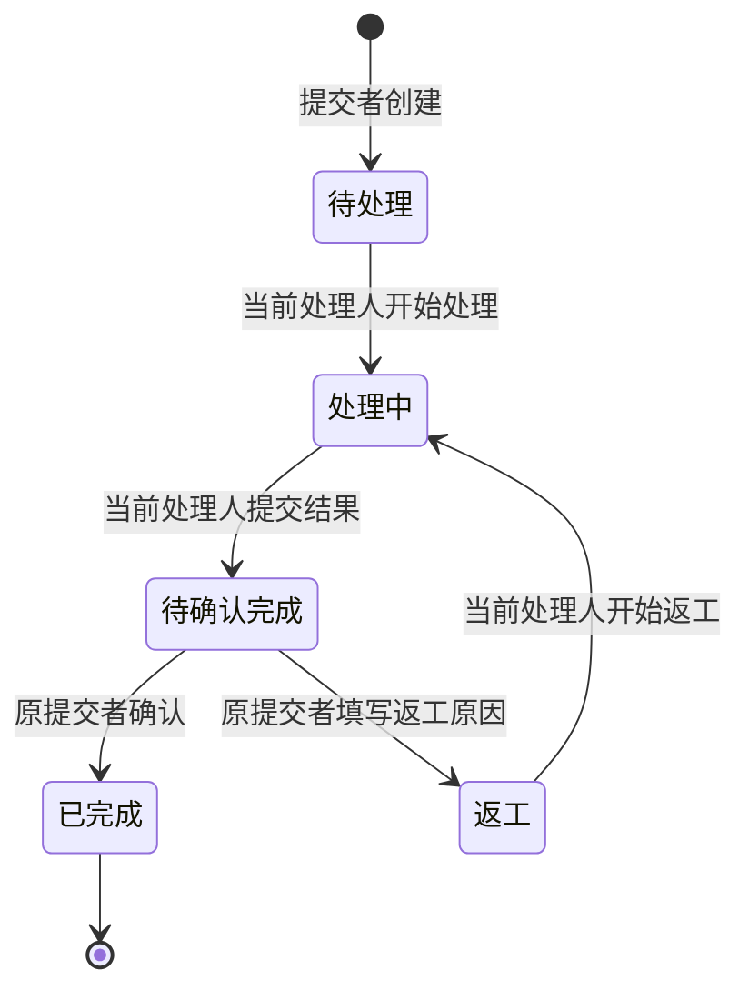
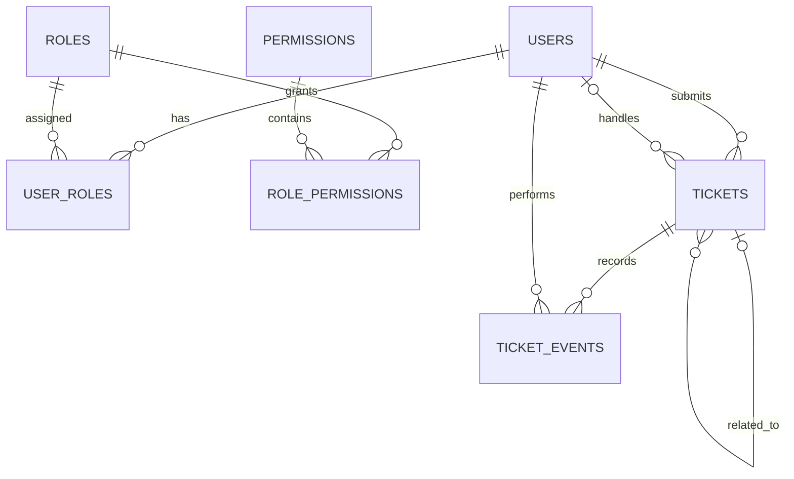

# 企业内部问题登记小助手需求规格说明书

- 版本：V1.0
- 日期：2026-10-21
- 目标：交付可本地运行、可验证、可演示的考核作品。
- 技术约束：Java、Spring Boot、Vue、MySQL、MinIO；预置账号密码登录；不依赖付费模型或真实企业 SSO。红点采用定时轮询。
- 权限设计：采用 RBAC，并叠加工单归属和状态校验，详见 [RBAC 权限设计](./RBAC权限设计.md)。

## 1. 业务目标与规模

将员工零散的故障、权限申请、功能建议和使用咨询整理为工单，保留原文，实现分类、分派、处理、返工和提交者确认的完整闭环。

背景规模为约 100 名员工、5 名技术支持，每天新增 20–100 条反馈，至少保留 3 年。首期用于模拟演示，不声明具备生产部署条件。

## 2. 用户与责任边界

| 角色 | 标识 | 责任 | 工单可见范围 |
| --- | --- | --- | --- |
| 提交者 | REQUESTER | 提供反馈、补充信息、验收处理结果 | 自己提交的工单 |
| 工单协调员 | COORDINATOR | 受理、核对分类、分派、转派，可领取并直接处理申请、咨询和建议 | 全部工单 |
| 技术支持 | SUPPORT | 排查处理、记录进度、提交处理结果 | 当前分派给自己的工单 |

协调员对工单流转负责；当前处理人（协调员或技术支持）对处理工作与结果说明负责；提交者负责确认本次反馈是否得到明确结论。

默认业务分工：故障通常分派给技术支持，申请、咨询和建议通常由协调员领取；待确认先由协调员澄清。分类不强制锁定处理人角色，系统不自动领取或分派。

系统仅登记和跟踪工作。实际权限审批与开通、故障修复、功能开发及上线在系统外进行。协调员不自动获得系统管理权限，技术支持不自动获得其他业务系统权限。

## 3. 首期范围

### 3.1 包含

1. 预置账号登录、退出，以及基于角色和数据归属的后端授权。
2. 反馈提交、原文保留、提交者手动选择分类、幂等提交。
3. 列表、详情、状态与类别筛选、分页。
4. 协调员分派、转派、纠正分类。
5. 支持人员开始处理、公开回复、提交结果。
6. 提交者补充信息、确认完成、要求返工。
7. 操作历史与已完成工单关联。
8. 可复现测试、启动文档、工程说明和约 5 分钟演示视频。
9. 提交者创建工单和补充信息时可附图片，使用私有 MinIO 桶保存，访问沿用工单权限。

### 3.2 不包含

企业 SSO、开放注册、账号和角色管理页面、聊天平台接入、图片以外的附件、内部私密备注、SSE/WebSocket 实时推送、催办、SLA、自动关闭、复杂审批、真实权限开通、外部模型、微服务和高可用部署。

## 4. 功能需求

### FR-01 登录和身份

- 预置至少两个提交者、一个协调员、两个技术支持账号，以验证隔离和转派。
- 首期每个账号分配一个业务角色；底层 RBAC 关系支持未来扩展。
- 身份取自服务端认证上下文。客户端传入的用户 ID、角色或可修改的页面存储不能作为授权依据。
- 密码使用 BCrypt 等合适的密码哈希保存，禁止明文存储；未登录请求不能访问业务数据。

### FR-02 提交及保留原文

- 输入包括 `request_id`、反馈原文、必选分类，以及可选的关联工单编号和图片。
- 提交人和提交时间由服务端产生，初始状态为“待处理”，初始处理人为空。
- 原文按收到的字符串保留；校验可以使用单独的规范化文本，不能覆盖原文。分类由提交者明确选择，不根据文字推断。
- 只有空格、换行、制表符、全角空格等空白字符的反馈拒绝保存。
- 首期约定：原文最多 10,000 个 Unicode 码点；request_id 为 1–64 位 ASCII 字母、数字、下划线或连字符，首尾空白不接受，按大小写敏感比较。具体校验错误应返回明确说明。
- 不提供原文修改或工单删除功能。已提交错误内容可通过补充信息更正。

### FR-03 幂等与冲突

- `request_id` 在当前系统全局唯一，使用数据库唯一约束保障，包括并发提交。
- 同一提交者、相同 request_id、相同原文、提交分类、关联编号和初始图片 token 集合：返回已有工单，不新增操作历史或重复绑定图片。
- 同一提交者、相同 request_id、不同原文、提交分类、关联编号或初始图片集合：返回冲突，禁止覆盖。
- 其他用户使用已存在的 request_id：返回通用冲突，不返回已有工单详情、提交人或内容。
- 不同 request_id 的相同文字允许生成不同工单；本期不做语义去重。

### FR-04 提交者选择分类

- 提交者每次创建工单时，必须主动选择：系统故障、权限申请、功能建议、使用咨询、待确认之一，页面不预选类型。
- 不确定类型时可以选择“待确认”；它是主动选择的合法类型，不是缺省值。未选择、空值或未知枚举必须拒绝。
- 系统不运行自动分类规则或模型，不根据原文更改提交者的选择，也不补造缺失信息。
- 保存提交者最初选择的分类 initial_category 和当前分类 category。协调员纠正时填写原因，在历史中记录前后类别，不能覆盖最初选择。
- 分类不改变工单状态；类别“待确认”与状态“待确认完成”相互独立。
- 即使反馈为“那个先不用了”，也按提交者选定类型登记，不能推断为撤销其他工单；协调员可后续联系确认。
- 此项按用户最新决定替换原任务书的自动类型识别要求，交付说明需如实注明手动选择方案。

### FR-05 查询

- 提交者查自己的工单；协调员查全部；技术支持查当前分派给自己的工单。
- 列表按创建时间倒序，支持状态、类别、request_id 筛选和分页，默认每页 20 条，最多 100 条。
- 详情包含原文、提交分类、当前分类及纠正历史、状态、提交人、当前处理人、处理结果、公开沟通、操作历史和有权查看的关联工单。
- 列表、详情、计数和关联查询必须使用同样的数据权限，禁止通过总数或历史接口泄露其他工单信息。

### FR-06 受理、分派和转派

- 受理表示协调员查看、核对和安排工单，不新增独立“受理中”状态。
- 协调员可将未完成工单分派或转派给有效 SUPPORT 或 COORDINATOR 账号，也可选择本人领取；不能分派给 REQUESTER。
- 分派不改变状态；转派也保持当前状态，包括“处理中”“待确认完成”“返工”。
- 首次分派记录操作；转派必须填写原因。重复分派给同一人不新增转派事件。
- 转派提交后，原支持人员失去该工单所有接口的访问权；新支持人员可查看完整历史。已被原人员读取的内容无法追溯收回。
- “待确认完成”时转派不取消已有处理结果；新处理人承担后续跟进，提交者仍可确认或要求返工。

### FR-07 沟通

- 提交者可以补充信息；协调员和当前支持人员可以回复。
- 回复、补充、转派原因、分类纠正原因、处理结果及返工原因全部对提交者可见，不设内部备注。
- 已发布记录不可修改或删除；更正通过新增记录表达。
- 已完成工单只读，所有角色均不能追加回复或改变业务字段。

### FR-08 处理、验收和返工

- 当前处理人（协调员或技术支持）将“待处理”改为“处理中”，表示开始工作；协调员查看全部的权限不能代替当前处理人归属条件。
- 当前处理人在“处理中”填写非空白处理结果，提交后进入“待确认完成”。故障为已解决；申请可通过或拒绝；咨询为已解答；建议可采纳、暂缓或拒绝，均必须说明结论。
- 仅原提交者可以在“待确认完成”确认完成，进入“已完成”。
- 原提交者认为未解决时，必须填写非空白原因，进入“返工”；当前处理人保持不变。
- 当前处理人开始返工时，状态回到“处理中”；再次提交结果后重新等待确认。历史结果保留，当前处理结论清空直至再次提交。
- 协调员不能代替提交者完成验收；本期不设置超时自动完成。
- “已完成”表示本次反馈有明确结论，不保证所有建议均被采纳。未采纳、拒绝等结论也应说明原因，并由提交者确认。
- 若提交者长期不确认或不认可拒绝结论，工单可持续未完成；超时和争议仲裁留待后续设计。

### FR-09 关联工单

- 已完成工单不重新打开。提交者仍有问题时新建工单，可关联自己之前已完成的工单。
- 使用内部工单 ID 建立关联关系，对用户展示编号；关联目标必须存在、属于本人且已完成。
- 新技术支持仅因新工单关联旧工单，不自动获得旧工单访问权；链接和预览需再次授权。新工单应独立说明当前问题。

### FR-10 操作历史

- 至少记录创建、分类纠正、分派、转派、开始处理、结果提交、返工、完成确认以及公开沟通。
- 包含操作人、操作时间、变更前后值和必要原因，禁止通过普通业务接口修改或删除。
- 状态、处理结果及对应历史在同一数据库事务内提交。

### FR-11 图片附件

- 提交者创建和补充时可上传图片，建议每工单累计最多 5 张、每张最多 5 MiB，格式 PNG/JPEG/WebP；文字仍为必填。
- 图片仅用于展示故障位置和功能建议；协调员和技术支持首期仅文字回复。
- MinIO 桶私有，MySQL 保存元数据和工单/事件关联。服务端检查真实格式、大小和解码尺寸，拒绝不符合要求的文件。
- 临时图片只对上传者可见；绑定后按工单权限访问。后端代理读取，不暴露永久公开 URL，转派后原处理人不能继续请求图片。
- 已绑定图片不可修改删除，补图通过新补充事件；已完成工单不允许补图。临时上传过期清理，绑定图片按工单保留。
- 上传与绑定、失败补偿及数据库字段详见 [数据库设计](./数据库设计.md)。

## 5. 状态模型

| 状态 | 标识 | 可执行的状态动作 |
| --- | --- | --- |
| 待处理 | PENDING | 当前处理人开始处理 |
| 处理中 | IN_PROGRESS | 当前处理人提交处理结果 |
| 待确认完成 | AWAITING_CONFIRMATION | 原提交者确认或要求返工 |
| 返工 | REWORK | 当前处理人开始返工 |
| 已完成 | COMPLETED | 无，保持只读 |

题目要求的“待处理、处理中、已完成”全部保留，另外两个状态用于表达验收与返工。接口执行业务动作，不允许客户端任意写入状态。

## 6. 数据模型概要

| 实体 | 主要内容 |
| --- | --- |
| users | 登录名、显示名、密码哈希、账号状态 |
| roles / permissions | 角色与权限码 |
| user_roles / role_permissions | 用户角色与角色权限关系 |
| tickets | 内部 ID、唯一 request_id、提交人、原文、提交时及当前分类、状态、当前处理人、关联 ID、时间、并发版本 |
| ticket_events | 工单、操作人、事件类型、变更内容、说明、时间；沟通及每次处理结果保存在历史中 |
| attachments | MinIO 桶和对象键、上传者、图片元数据、临时状态、绑定工单和事件 |
| notifications | 接收人、工单和事件、通知类型、已读及失效时间，用于红点轮询 |

原文、沟通和操作历史至少保留三年；本期不实现自动清理。生产环境需明确备份、恢复验证和保留到期处理制度。

## 7. 页面范围

1. 登录页：账号密码登录、错误提示。
2. 提交者工作台：新建工单（分类必选且不预选）、自己的列表与筛选。
3. 协调员工作台：全部工单、未分派筛选、分类纠正、分派转派。
4. 技术支持工作台：当前分派列表、待处理/返工/待确认完成筛选。
5. 工单详情：原文、状态、历史、公开沟通；按角色、归属和状态显示可执行动作。

## 8. 一致性、安全与非功能要求

- 使用数据库唯一约束、外键和事务保障数据一致性，MySQL request_id 唯一比较需与大小写敏感约定一致。
- 工单引入版本号，状态变更、分派和写入沟通时在事务中重新检查版本、归属和状态。转派与原支持人员操作并发时不得依赖过期授权；冲突返回刷新提示。
- 服务重启后数据仍然可查询；列表必须分页。
- 使用参数化查询/ORM，页面将原文和回复作为文本渲染，禁止执行用户输入的 HTML 或脚本。
- 登录使用服务端会话，Cookie 设置 HttpOnly、SameSite，状态变更请求启用 CSRF 防护；生产 HTTPS 下启用 Secure。
- 正常业务日志不记录密码、会话凭据和完整反馈正文。开发异常不向页面暴露堆栈或数据库连接信息。
- 本地演示默认仅监听本机；公开默认演示密码不得用于生产。

## 9. 验收案例与交付要求

以下为待实现后的验收案例，不代表当前已有测试通过。

| 编号 | 场景 | 预期 |
| --- | --- | --- |
| AC-01 | 提交“登录页面一直转圈，我进不去”并选择系统故障 | 保留原文、提交分类与当前分类均为系统故障、待处理、提交人正确 |
| AC-02 | 同账号同编号同内容重试及并发提交 | 只产生一张工单，返回同一 ID |
| AC-03 | 同编号不同内容、其他账号使用已有编号 | 冲突且原记录不变；不泄露原工单 |
| AC-04 | 空格、换行、制表符或全角空格组成的反馈 | 拒绝保存 |
| AC-05 | 未选分类、未知类型，以及主动选择待确认 | 前两者拒绝；主动选择待确认可保存，不从文字推断类型 |
| AC-06 | 提交者 A 直接请求 B 的列表、详情、历史或写入接口 | 无法访问 B 的数据 |
| AC-07 | 协调员分派、支持人员开始及提交结果、提交者确认 | 依次待处理、处理中、待确认完成、已完成 |
| AC-08 | 提交者拒绝结果并返工 | 必填原因、状态返工、原处理人保留，可再次处理验收 |
| AC-09 | 转派给另一支持人员 | 状态保持，原支持失去权限，新支持看到完整历史 |
| AC-10 | 员工分派、协调员确认完成、支持人员操作他人工单 | 后端拒绝，数据不变 |
| AC-11 | 已完成工单被回复、转派、改分类或改状态 | 全部拒绝；可以另建关联工单 |
| AC-12 | 两人并发修改或转派同时原支持提交结果 | 无静默覆盖或过期归属写入，冲突可解释 |
| AC-13 | 重启服务后查询工单及历史 | 数据和状态持久存在 |
| AC-14 | 反馈包含脚本标签 | 页面按文字显示，不执行脚本 |
| AC-15 | 同 request_id 同原文但改变提交分类重试 | 返回冲突，不覆盖原提交分类 |
| AC-16 | 协调员纠正分类后，提交者按原始分类重试原请求 | 返回原工单；最初选择不变，当前类别不被重试覆盖 |

最终交付源代码、启动 README、测试执行结果、结构/数据模型图、工程取舍说明、真实 AI Coding 使用说明及约五分钟演示视频。不得将测试计划写成已通过结果。

## 10. 工程取舍与演进

- 首期单体应用和简单页面，优先打通权限明确的业务闭环。
- 分类采用提交者必选，不依赖规则、模型或 Key；取舍是提交者需要自行判断，协调员可纠正。不将手动选择描述为自动识别。
- 预置角色和权限关系，不提供权限管理页面，减少越权配置入口。
- 上线前仍需企业身份接入、HTTPS、凭据管理、登录限流、依赖安全检查、备份恢复、部署监控及隐私保留制度。
- 用户与角色扩展时增加组织或服务组范围，不以新增角色代替数据隔离；并发增长时评估索引、连接池和锁等待，再决定架构调整。
- 只能再做三项改进时，优先企业身份与账号生命周期、备份恢复演练、错误监控与告警，使身份可控、数据可恢复、故障可发现。

## 11. 当前文档状态

本文件为需求基线。基础工程已建立，进度见根目录 README；本文件中的完整业务验收案例仍待实现执行，尚未录制演示。具体表结构与 API 在实现设计时细化，不能改变上述角色、信息与责任边界。
